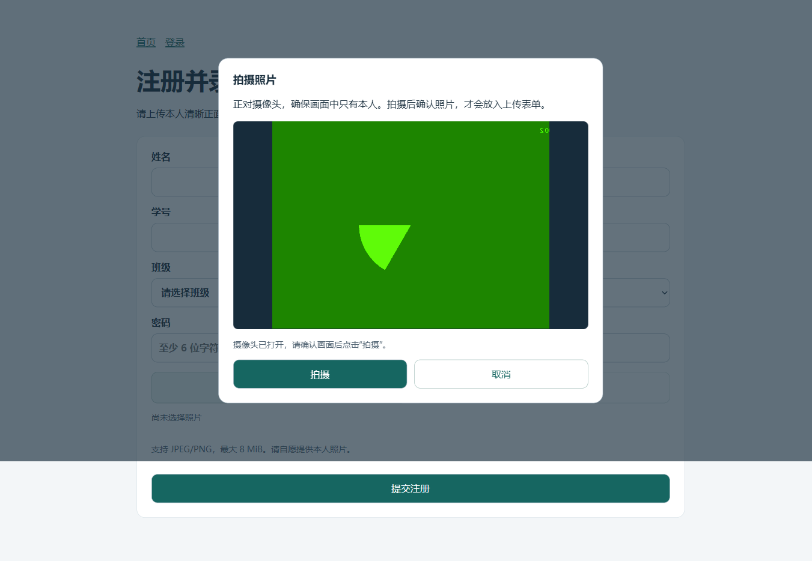
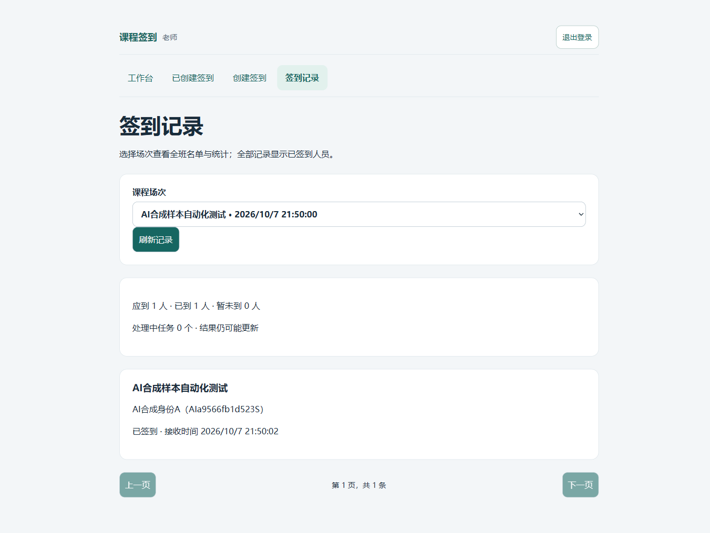

# 电脑端拍照修复与实际测试（2026-10-07）

## 结果

桌面“拍照”已改为摄像头实时取景、拍摄、预览确认，再由用户提交。注册、照片库、签到三个页面均使用同一流程。子智能体全面检查实际桌面操作后发现的另外三处界面问题也已修复并独立复测。

开发 API、worker、scheduler 已更新到 `sha256:adc9c385931782544cf9f6dceaec79690f8cb78ce4cb7de20f6c78ab109bb13c`；本机 `http://localhost:8000` 与当前局域网 `http://192.168.31.29:8000` 的 ready 均返回 200。MySQL、Redis、模型 worker 正常，见 [运行状态](desktop-camera-2026-10-07/final-runtime.json)。测试后的隔离栈已停止，开发栈保留供继续使用。

## 原因与修改

原来的“拍照”只点击带 `capture="user"` 的文件输入。该属性是手机原生拍摄入口的提示，桌面 Edge 实际仍打开文件选择器。修复前在浏览器中点击按钮并捕获了真实文件选择事件，确认了用户反馈。

- 桌面使用 `getUserMedia` 的视频轨道，绘制 JPEG 快照；“使用这张照片”才填入表单，之后提交才上传。单独的“选择照片文件”才打开文件选择器。
- 拍摄、取消、Esc、离开页面及页面隐藏会释放摄像头；重拍重新取景。权限拒绝、设备缺失或占用等显示中文提示。
- 手机继续使用原生拍照输入和独立相册入口。浏览器回归已修正手机 User-Agent，避免把桌面缩窄窗口误当手机拍照行为。
- 统一网络错误文案，断网不再显示 `Failed to fetch`。
- 注册页先检查会话，登录用户转工作台并停止注册初始化；不读取遗留注册任务。
- 照片库删除末页唯一照片后，回到有效页码显示剩余照片。
- LAN Compose 同时保留回环发布，便于在服务器本机使用 localhost 安全上下文。远程 HTTP 的电脑实时拍照会明确提示需要 HTTPS。

## 实际浏览器与后端验证

所有以下实际检查使用有窗口的 Microsoft Edge，连接真实 FastAPI / MySQL / Redis / Celery / ONNX；没有替换接口响应或修改识别阈值。

|检查|结果与证据|
|---|---|
|全面桌面审查|子智能体两轮完成 70 项实际操作，覆盖访客、注册失败恢复、登录/退出、角色隔离、老师发布/关闭、学生发现场次、照片库操作、名单/记录分页、键盘与多窗口尺寸。发现的三项问题均已独立复测修复，见 [审查及复测报告](desktop-audit-2026-10-07.md)|
|原生取景流程|23 项检查全部通过：三页取景/拍摄/确认，JPEG 文件填入，未确认不上传，拍摄停止轨道，取消/Esc/重拍/离开页面，1920/1366/1024/640/390 宽窗口，权限拒绝与恢复，独立文件选择入口，精确清理。见 [结果](desktop-camera-2026-10-07/results.json)|
|摄像头上传执行链|原生虚拟视频的 JPEG 实际上传，注册、照片库、签到各有一个真实终结 `NO_FACE` 任务；无脸不会激活账号、生成标准照或产生签到成功记录|
|运行环境限制|零个原生虚拟视频设备返回缺少摄像头；重试/取消正常；实际 LAN HTTP 显示安全上下文原因，localhost 可调用原生设备检查；全程无开发数据提交，见 [环境结果](desktop-camera-2026-10-07/environment-results.json)|
|合成人脸完整流程|桌面实际注册、登录、老师创建、匿名识别、重复签到、未录入人员拒绝、冻结名单、新场次签到和老师记录展示；真实模型完成 18 个任务，产生 4 条记录，特征 512 维、归一化范数 1.0。见 [模型与数据库结果](desktop-camera-2026-10-07/biometric/ai-face-results.json)|
|并发重复签到|同一合成身份的 10 个并发请求返回 1 次 `CHECKED_IN`、9 次 `ALREADY_CHECKED_IN`，该场次仅一条签到记录；这不代表不同真人的吞吐量评估|





7 组补充浏览器 fixture 回归通过：注册恢复、页面恢复与任务重试、390/1366 宽角色流程，以及 Chromium/WebKit/Firefox 的链接与结果反馈回归。它们使用明确的接口夹具，仅作为补充回归，不能代替上面的真实交互证据，也不证明实体 iPhone/安卓设备已验收。

## 测试中断与处理

- 摄像头脚本首次通过控制台观察导航释放状态时未捕获事件；改为页面离开事件写入临时浏览器 sessionStorage，下一页读取轨道 `ended` 状态，验证通过。
- 第二次摄像头脚本使用错误的 CDP 权限名称 `videoCapture` 导致测试配置中断，保留 [原始失败结果](desktop-camera-2026-10-07/attempt-permission-config.json)。改为临时浏览器上下文的 `camera` 权限后全流程通过，没有改变系统或日常浏览器设置。
- WebKit/Firefox 的补充回归首次未找到默认位置的浏览器运行时，指定此前已安装的 `E:\Mobile-Emulators\WebTests\Browsers` 后通过，没有重新下载。
- 子智能体图库复测中浏览器被关闭导致 `TargetClosedError`，失败结果保留，并重新启动浏览器补完剩余记录测试，详见其报告。

## 重跑与边界

先按本地手册启动隔离测试 API（8001）及 worker，停止测试 scheduler，避免定时清理干扰。宿主机需要项目虚拟环境、Playwright 和 Edge；合成人脸脚本还需要已有的私有合成样本。

```powershell
.venv\Scripts\python.exe tests/browser/check_desktop_camera.py
.venv\Scripts\python.exe tests/browser/check_desktop_camera_environment.py --lan-url http://192.168.31.29:8000
.venv\Scripts\python.exe tests/browser/check_desktop_biometrics.py
```

摄像头脚本只使用浏览器原生虚拟设备，没有打开实体摄像头；合成人脸不是现实人员，不能据此判断真人识别准确率。实体摄像头权限、设备占用和本人照片的实际验收仍待提供条件；设备占用提示目前只有代码路径，未用实体设备复现。手机和云部署不属于本次桌面验收范围。

临时用户、班级、场次、照片、记录、会话及任务容量均已按随机标记/确切 ID 清理；最后隔离库有效人脸数、未结束任务数、Redis 容量预留数均为 0。开发数据库只做页面访问与健康读取。保留正式截图、结果及重跑脚本，未提交或推送 Git。

测试结束尝试删除本次 `.tmp/desktop-fixture-regression`、`.tmp/desktop-positive-20261007`、`.tmp/desktop-audit-20261007` 时，删除命令包含目标必须位于项目 `.tmp` 内的校验，但自动审批在执行前以 `blocked by policy` 拒绝，未提供更具体理由。这些目录因此保留，没有改用其他删除方式；正式测试脚本和证据已另存。
